# 📋 EcoWatch SJDM — Visual Bug & Suggestion Tracker

> **Lifecycle Rules**:
> - `[ ]` **Open / Pending**: Reported and documented with screenshot.
> - `[/]` **Fixed by Agent**: Implemented and code-verified. Ready for user testing.
> - `[x]` **Confirmed Good**: User tested and approved. Entry can be cleaned up and the screenshot deleted to save disk space.
>
> **Screenshots Directory**: [`docs/bug-tracker/screenshots/`](./docs/bug-tracker/screenshots/)

---

## Quick Summary

| ID | Type | Title | Module | Status |
|---|---|---|---|---|
| **#1** | 🐛 Bug | Cleanup Resolution Proof displayed on failed cleanup | Public Tracker (`/track/[id]`) | `[/]` Fixed by Agent |
| **#2** | 🐛 Bug | "Pending / Verified" KPI in CENRO shows 0 (`ai_verified` omitted) | CENRO Oversight (`OversightTab.tsx`) | `[/]` Fixed by Agent |
| **#3** | 🐛 Bug | Severe light mode contrast failures (WCAG AA/AAA) | Detail Drawer & Drilldown Modal | `[/]` Fixed by Agent |
| **#4** | 🐛 Bug | No toast notification after clicking "Confirm Duplicate" | Report Drawer (`ReportDetailDrawer.tsx`) | `[/]` Fixed by Agent |
| **#5** | 🎨 UI/UX | Drawer "Timeline" tab is an unformatted raw text dump | Report Drawer (`ReportDetailDrawer.tsx`) | `[/]` Fixed by Agent |
| **#6** | 🐛 Bug | Able to reassign Barangay jurisdiction on resolved reports | Report Drawer & Backend API | `[/]` Fixed by Agent |
| **#7** | 🚀 Feature | CENRO Emergency Dispatch / Direct Work Order Creation | CENRO Drawer & Backend Work Orders | `[/]` Fixed by Agent |
| **#8** | 🐛 Bug | Resolution Rate in Analytics shows 100% (`ai_verified` omitted) | Backend Analytics (`analytics.py`) | `[/]` Fixed by Agent |
| **#9** | 🐛 Bug | Premature day rounding displays 2.4h instead of 16m (D:H:M:S format) | Backend Analytics & Frontend KPI | `[/]` Fixed by Agent |
| **#10** | 🐛 Bug | "Reassign Admin" opens personal edit form instead of selector | Barangay Management Drawer | `[/]` Fixed by Agent |
| **#11** | 🐛 Bug | Bulk import shows "Failed: Unknown error" & hides passwords | User Management (`UserManagementTab.tsx`) | `[/]` Fixed by Agent |
| **#12** | 🎨 UI/UX | "Add New User" modal form is too static and unpolished | User Management (`UserManagementTab.tsx`) | `[/]` Fixed by Agent |
| **#13** | 🎨 UI/UX | Barangay Dashboard "Recent Reports" is plain and sparse | Barangay Dashboard (`barangay/page.tsx`) | `[/]` Fixed by Agent |
| **#14** | 🐛 Bug | Barangay Review tab permanently stuck on skeletal loader | Barangay Review (`barangay/page.tsx`) | `[/]` Fixed by Agent |
| **#15** | 🐛 Bug | Barangay Map View completely blank / not rendering | Barangay Map (`barangay/page.tsx`) | `[/]` Fixed by Agent |
| **#16** | 🐛 Bug | "Open" column in Barangay reports shows dashes (`—`) | SLA Helper (`lib/sla.ts`) & Barangay | `[/]` Fixed by Agent |
| **#17** | 🎨 UI/UX | Remove redundant "Manage" button in Barangay table | Barangay Reports (`barangay/page.tsx`) | `[/]` Fixed by Agent |
| **#18** | 🐛 Bug | Drawer "AI Verified" banner & pill persist after human verify | CENRO Portal & Drawer (`ReportDetailDrawer.tsx` / `cenro/page.tsx`) | `[/]` Fixed by Agent |
| **#19** | 🐛 Bug | Report marked as duplicate still shows AI Verified banner & cannot be approved | CENRO Drawer & Backend (`ReportDetailDrawer.tsx` / `backend/main.py:4145`) | `[/]` Fixed by Agent |
| **#20** | 🐛 Bug | "Reassign Admin" crashes with 500 error page (`setShowReassignModal is not defined`) | Barangay Drawer (`BarangayDetailDrawer.tsx`) | `[/]` Fixed by Agent |
| **#21** | 🐛 Bug | DevOptionsModal throws `Requires role: cenro` on open & fails to toggle presentation mode without CENRO session | Dev Options (`DevOptionsModal.tsx` & Backend) | `[/]` Fixed by Agent |
| **#22** | 🐛 Bug | Date Reported on Track view displays UTC time (11:09 PM) instead of local time (7:09 AM) | Public Tracker (`/track/[id]`) & Date Utils | `[/]` Fixed by Agent |
| **#23** | 🐛 Bug | Leaked VLM / Gemini Clues & Disguised AI Summary Card on Defense Mode | Report Drawer, Track Page, Cleanup Card | `[/]` Fixed by Agent |
| **#24** | 🚀 Feature | Clickable DBSCAN Hotspot Clusters & Detailed Reports Breakdown | CENRO City Map (`cenro/page.tsx`, `backend/analytics.py`) | `[ ]` Open / Pending |
| **#25** | 🐛 Bug | City-Wide SLA Compliance shows 100% when active breaches exist | Backend SLA Analytics (`backend/main.py:5075`) | `[ ]` Open / Pending |
| **#26** | 🐛 Bug | Low contrast & misleading blue color on "BREACHED" status pill | SLA Tab (`SlaManagementTab.tsx:78, 317`) | `[ ]` Open / Pending |

---

## Detailed Items

### - [/] 🐛 Bug #1: "Cleanup Resolution Proof" shows on public tracking page when cleanup failed (`failed_cleanup`)

* **Page:** Public Tracker (`frontend/app/track/[id]/page.tsx:378`)
* **Screenshots:**
  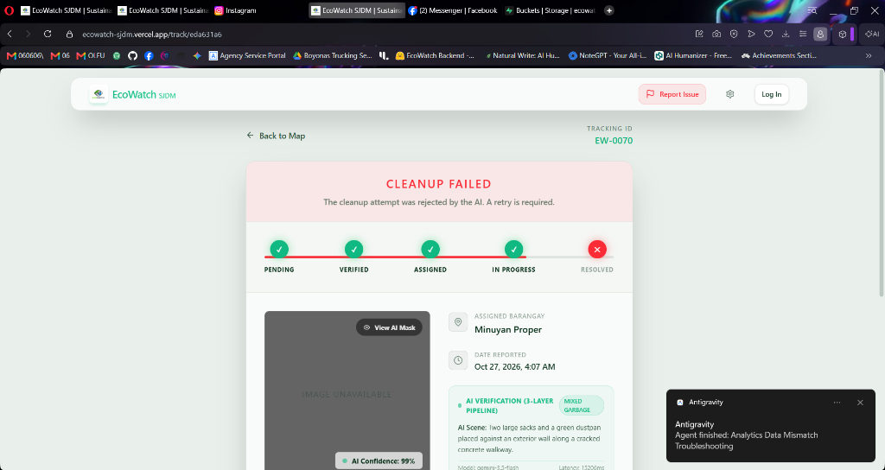
  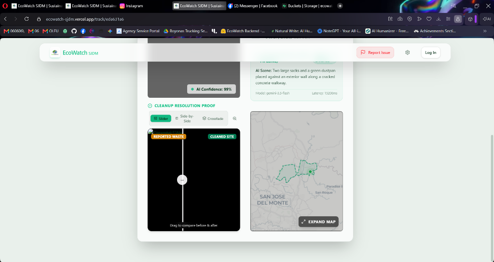
* **What happens:** When cleanup fails AI verification (status = `failed_cleanup`), the top banner correctly shows `"CLEANUP FAILED"`, but the page still displays a section titled `"CLEANUP RESOLUTION PROOF"` with a green checkmark and `"CLEANED SITE"` slider comparison.
* **Root Cause:** Line 378 checks `{report.cleanup_image_url && (...)}` without verifying `report.status === 'resolved'`.
* **Fix Plan:** Only render the resolution proof section when `report.status === 'resolved'`. For `failed_cleanup`, keep proof hidden or show an informational re-cleaning notice.
* **Verification Step:** Open a report in `failed_cleanup` status on `/track/[id]` and confirm no green "Resolution Proof" slider appears.

---

### - [/] 🐛 Bug #2: "Pending / Verified" KPI in CENRO shows 0 because it omits `ai_verified`

* **Page:** CENRO Portal (`frontend/components/portal/OversightTab.tsx:170` & `frontend/app/cenro/page.tsx:617, 636`)
* **Screenshots:**
  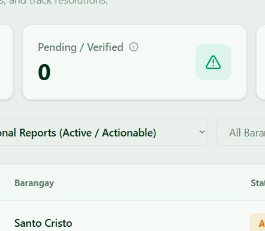
  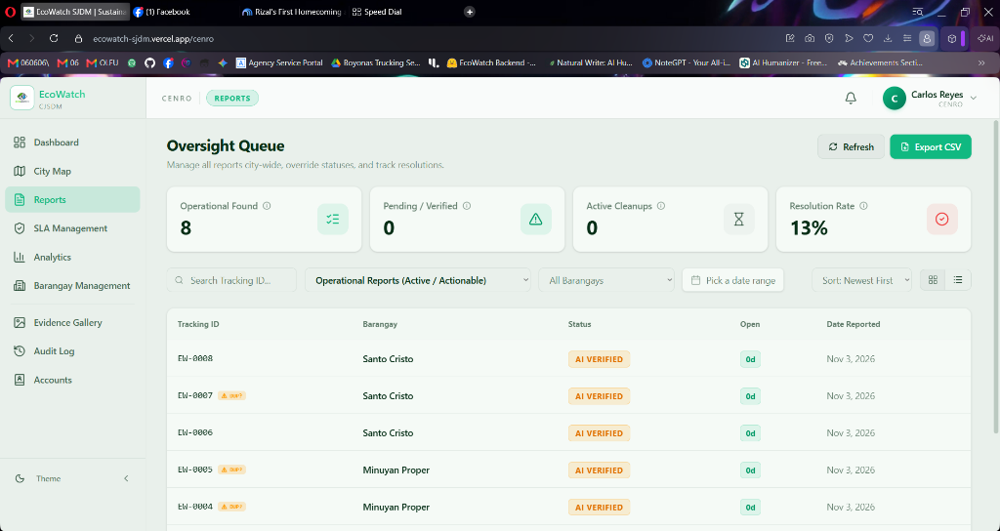
  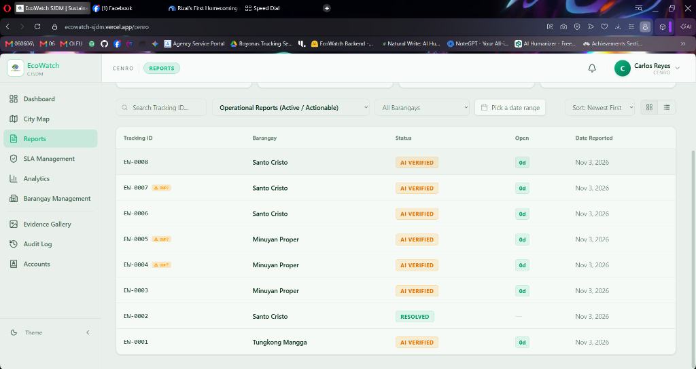
* **What happens:** In CENRO Reports, the KPI card shows `0` for "Pending / Verified" even though 7 out of 8 reports in the queue have status `AI VERIFIED`.
* **Root Cause:** Filter strictly checks `r.status === 'pending' || r.status === 'verified'`, completely skipping `ai_verified` and `ai_rejected`.
* **Fix Plan:** Update the filter condition to:
  `['pending', 'verified', 'ai_verified', 'ai_rejected'].includes(r.status)`
* **Verification Step:** Check the CENRO Reports KPI card and confirm it accurately reflects the 7 AI-verified reports.

---

### - [/] 🐛 Bug #3: Severe contrast & legibility issues in light mode (Accessibility)

* **Pages:** `ReportDetailDrawer.tsx:142, 651` & `AnalyticsDrilldownModal.tsx:33-46`
* **Screenshots:**
  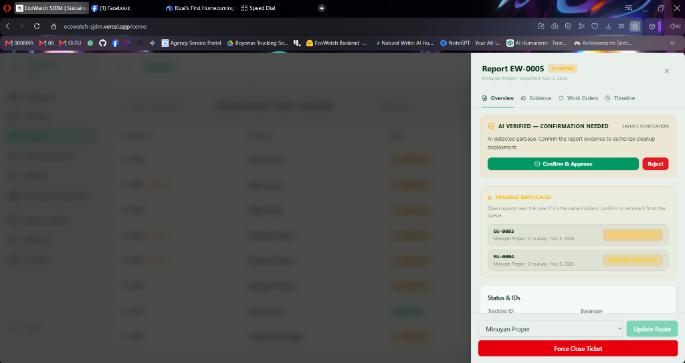
  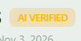
  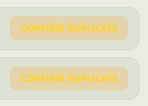
* **What happens:**
  1. "Confirm Duplicate" button has yellow text on pale yellow button (`text-amber-300` on `bg-amber-500/20`), making text nearly invisible in light mode.
  2. "AI VERIFIED" badge uses `text-amber-400` on light cream, failing WCAG 4.5:1 minimum contrast.
  3. Secondary metadata uses `text-foreground/40`, creating washed-out grey text that strains the eyes.
* **Fix Plan:**
  - "Confirm Duplicate": Use high-contrast tokens (`text-amber-900 bg-amber-100 border border-amber-300 dark:text-amber-300 dark:bg-amber-950/40`).
  - "AI VERIFIED": `text-amber-800 dark:text-amber-300 bg-amber-500/15 border-amber-500/30`.
  - Secondary metadata: Boost opacity to `>= 70%` (`text-foreground/70`).
* **Verification Step:** Switch to Light mode, open the drawer, and verify all button labels and status badges are effortlessly readable.

---

### - [/] 🐛 Bug #4: No toast notification after clicking "Confirm Duplicate"

* **Page:** Report Detail Drawer (`frontend/components/portal/ReportDetailDrawer.tsx:622`)
* **What happens:** Clicking "Confirm Duplicate" successfully marks the duplicate via API and closes the drawer, but emits **no toast confirmation**, leaving the admin confused about whether it saved.
* **Root Cause:** Function `confirm()` in `DuplicateAlert` calls `onConfirmed()` without triggering `toast.success()`.
* **Fix Plan:** Add `toast.success("Marked as duplicate. Report removed from active queue.")` before calling `onConfirmed()`.
* **Verification Step:** Click "Confirm Duplicate" on a flagged report and confirm a green success toast appears.

---

### - [/] 🎨 Improvement #5: Unformatted raw text dump in Drawer "Timeline" tab

* **Page:** Report Detail Drawer (`frontend/components/portal/ReportDetailDrawer.tsx:1274-1315`)
* **Screenshots:**
  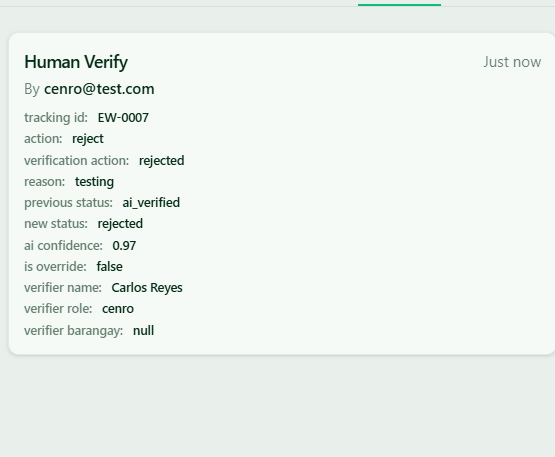
  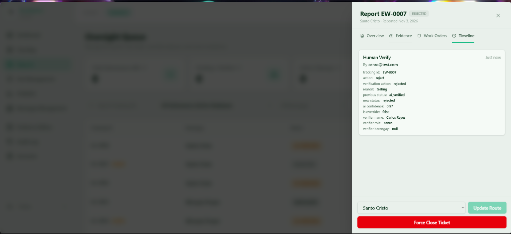
* **What happens:** The timeline dumps raw database dictionary keys like `is override: false`, `verifier barangay: null`, raw floats (`0.97`), and duplicate action names.
* **Fix Plan:** Redesign into a proper vertical timeline card:
  - Top header with action badge (`[APPROVED]`, `[REJECTED]`) and user role.
  - Status transition pill: `[ AI VERIFIED ] ➔ [ REJECTED ]`.
  - Emphasized reason quote box for human notes.
  - Clean formatted confidence percentage (`97%`).
  - Filter out internal debug fields (`null`, `is_override`, `tracking_id`).
* **Verification Step:** Open Timeline tab on any reviewed report and confirm it renders a clean card with no raw JSON dump.

---

### - [/] 🐛 Bug #6: Able to change / reassign Barangay on already `resolved` reports

* **Page:** Report Detail Drawer (`frontend/components/portal/ReportDetailDrawer.tsx:578`) & Backend API (`backend/main.py:3915`)
* **Screenshots:**
  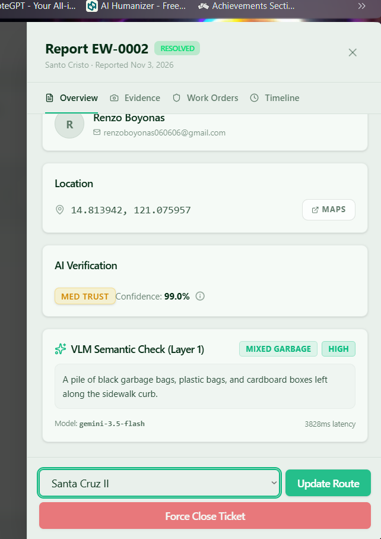
* **What happens:** When opening a `resolved` report (e.g. `EW-0002`), the Barangay dropdown and "Update Route" button remain completely enabled, allowing reassignment of closed tickets.
* **Root Cause:** Frontend disable condition only checks `newBarangay === report.barangay` without checking status. Backend has no guard clause.
* **Fix Plan:**
  - Frontend: Disable dropdown and button when `['resolved', 'rejected', 'duplicate'].includes(report.status)`.
  - Backend: Return `400 Bad Request` if attempting to reassign a closed ticket.
* **Verification Step:** Open a resolved report; ensure the Barangay selector and button are disabled with an explanatory tooltip.

---

### - [/] 🚀 Feature #7: CENRO Emergency Dispatch / Direct Work Order Creation

* **Page:** CENRO Drawer Work Orders Tab & Backend API (`backend/main.py:3325`)
* **Screenshots:**
  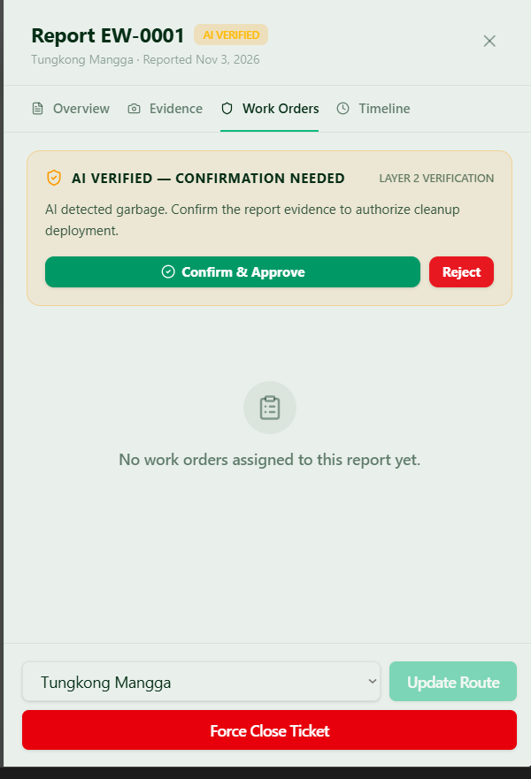
* **What happens:** Currently, only Barangay admins can create work orders (`POST /work-orders` has `require_role("barangay")`). If a barangay breaches SLA or is unresponsive, CENRO cannot directly deploy cleaners.
* **Fix Plan:**
  1. Backend: Allow `cenro` role in `POST /work-orders`.
  2. Frontend: Add a "Direct Work Order Dispatch" modal in CENRO's `Work Orders` tab allowing CENRO to select an available cleaner in that barangay (or CENRO quick-response team) and deploy immediately.
* **Verification Step:** Log in as CENRO, open a verified report, click "Dispatch Cleaner", assign a cleaner, and confirm work order creation.

---

### - [/] 🐛 Bug #8: Resolution Rate in Analytics shows 100% because `ai_verified` is omitted from denominator

* **File:** `backend/analytics.py:115`
* **Screenshots:**
  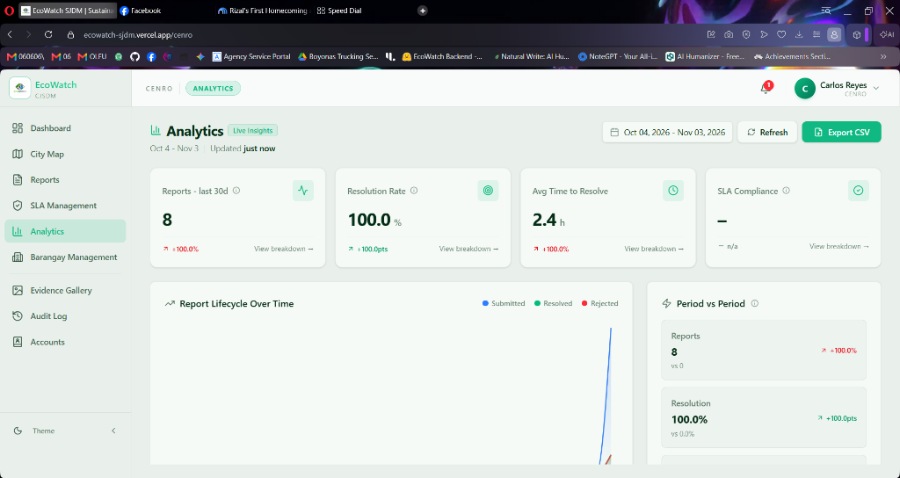
* **What happens:** In Analytics tab, Resolution Rate displays `100.0%` even though there are 8 total reports and only 1 resolved.
* **Root Cause:** `_RESOLUTION_DENOM_STATUSES = {"resolved", "verified", "assigned", "in_progress", "failed_cleanup"}` excludes `ai_verified`. The 7 AI-verified reports were skipped, calculating $1 \div 1 = 100\%$.
* **Fix Plan:** Add `"ai_verified"` to `_RESOLUTION_DENOM_STATUSES`.
* **Verification Step:** Reload Analytics tab and verify Resolution Rate shows the accurate rate ($1 \div 8 = 12.5\% \approx 13\%$).

---

### - [/] 🐛 Bug #9: Premature day-rounding causes Avg Resolution Time to display "2.4h" instead of actual minutes

* **Files:** `backend/analytics.py:158` & `frontend/components/portal/AnalyticsTab.tsx:388`
* **Screenshots:**
  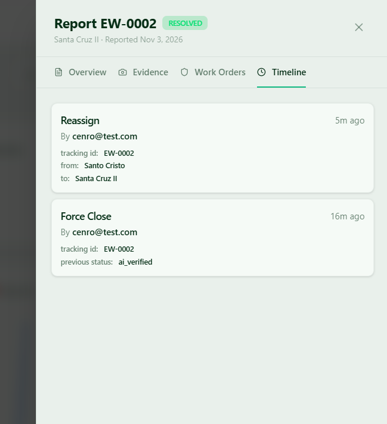
  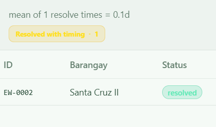
* **What happens:** A ticket resolved in 16 minutes displays as `2.4 h` on the KPI card and `0.1d` in the drilldown modal.
* **Root Cause:** Backend calculates in days and prematurely rounds to 2 decimals: `round(16min / 1440min, 2) = 0.1 days`. The frontend multiplies `0.1 * 24` which equals `2.4 hours`!
* **Fix Plan:**
  1. Backend: Return exact seconds or unrounded float days.
  2. Frontend: Format the duration accurately as **`00:00:00:00` (`DD:HH:MM:SS`)** or dynamic human string (e.g. `00d 00h 16m 00s`), eliminating misleading hour inflations.
* **Verification Step:** Verify that a 16-minute resolution displays as `00:00:16:00` (or `16m`).

---

### - [/] 🐛 Bug #10: "Reassign Admin" opens "Edit Account Details" form instead of a reassignment selector

* **Page:** CENRO Barangay Management (`frontend/app/cenro/page.tsx:324` & `BarangayDetailDrawer.tsx:359`)
* **Screenshots:**
  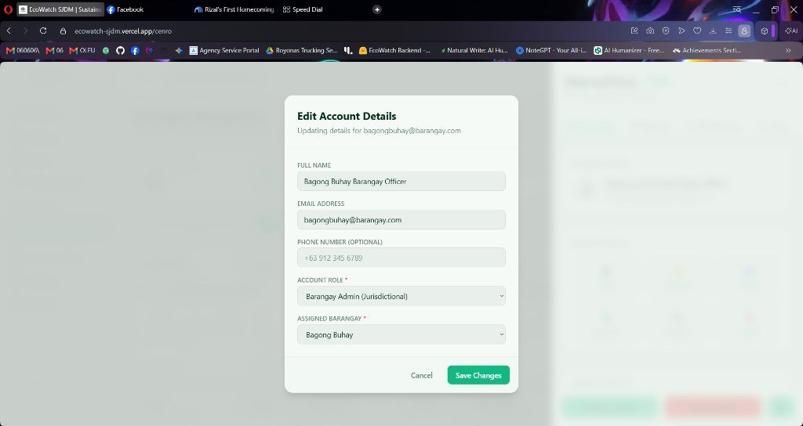
* **What happens:** Clicking "Reassign Admin" opens the current officer's personal edit form (`openEditForBarangay`), forcing the user to manually retype names and email addresses.
* **Fix Plan:** Replace with a dedicated **"Reassign Barangay Admin"** dialog featuring a searchable dropdown of available users or a one-click account picker.
* **Verification Step:** Click "Reassign Admin" on any barangay; confirm a selector modal opens rather than the personal account edit form.

---

### - [/] 🐛 Bug #11: Bulk Import Accounts shows rows as "Failed: Unknown error" and hides passwords

* **Page:** User Management (`frontend/components/portal/UserManagementTab.tsx:999-1009`) & Backend (`backend/main.py:1491`)
* **Screenshots:**
  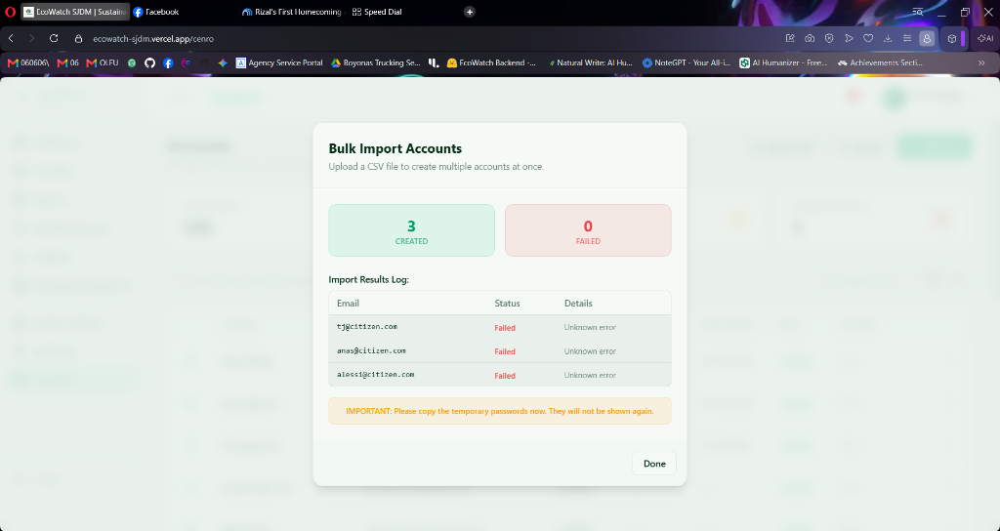
  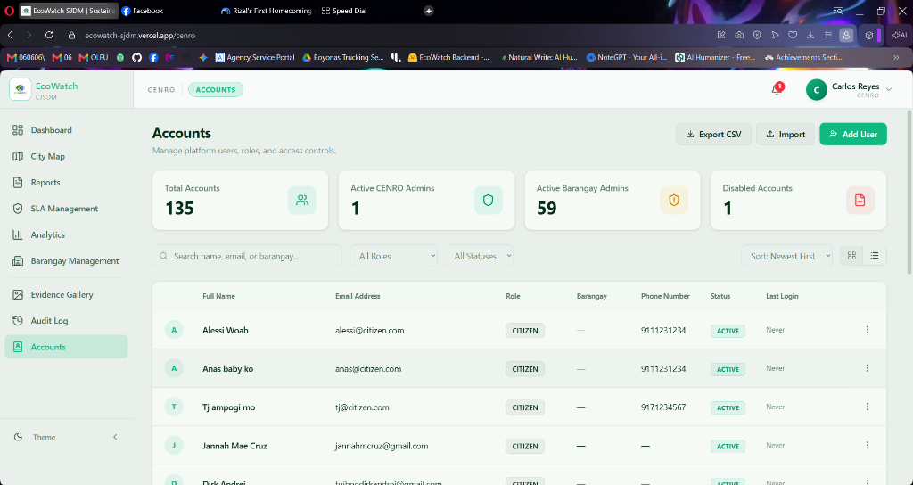
* **What happens:** Summary card shows `3 CREATED / 0 FAILED`, and accounts are created in DB, but the table displays `Failed: Unknown error` for all rows and **hides the temporary passwords**.
* **Root Cause:** Backend returns `"status": "created"`, but frontend checks for `"status": "success"`.
* **Fix Plan:** Update frontend condition to `r.status === "created" || r.status === "success"`.
* **Verification Step:** Run a bulk CSV import; verify rows show green `Success` and display `Temp PW: <password>`.

---

### - [/] 🎨 Improvement #12: Redesign static "Add New User" and "Edit Account" forms to modern EcoWatch standards

* **Page:** User Management (`frontend/components/portal/UserManagementTab.tsx:692-750`)
* **Screenshots:**
  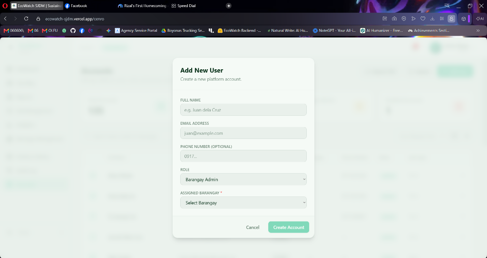
* **What happens:** The form is very flat and static with plain grey inputs, native browser select dropdowns, and no visual role cards.
* **Redesign Plan:**
  1. Visual Role Cards with icons (CENRO 🛡️, Barangay 🏛️, Cleaner 🧹, Citizen 👤).
  2. Input icons (`User`, `Mail`, `Phone`, `MapPin`) with sleek focus glow rings.
  3. Searchable combobox for Barangay picker.
  4. Glassmorphic modal styling and eco-gradient submit button.
* **Verification Step:** Open "Add User" modal and verify modern interactive styling.

---

### - [/] 🎨 Improvement #13: Barangay Dashboard "Recent Reports" is plain and sparse

* **Page:** Barangay Dashboard (`frontend/app/barangay/page.tsx:1005-1065`)
* **Screenshots:**
  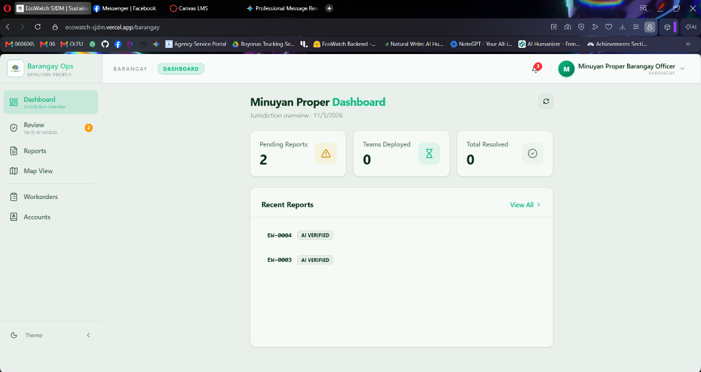
  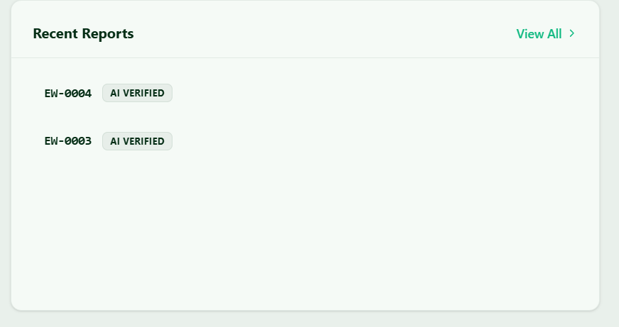
* **What happens:** The card only displays the tracking ID and AI VERIFIED badge, leaving vast empty whitespace with no photo thumbnail, timestamp, notes, or location.
* **Redesign Plan:**
  - Add photo thumbnail preview.
  - Display relative timestamp (*e.g. "2 hours ago" / "Nov 3, 2026"*).
  - Add citizen notes and location snippet.
  - Display elapsed open duration timer (*`DD:HH:MM:SS`*).
* **Verification Step:** Open Barangay Dashboard and verify Recent Reports renders an informative preview card for each report.

---

### - [/] 🐛 Bug #14: Barangay Review tab permanently stuck on skeletal loader

* **Page:** Barangay Review Tab (`frontend/app/barangay/page.tsx:1267-1286`)
* **Screenshots:**
  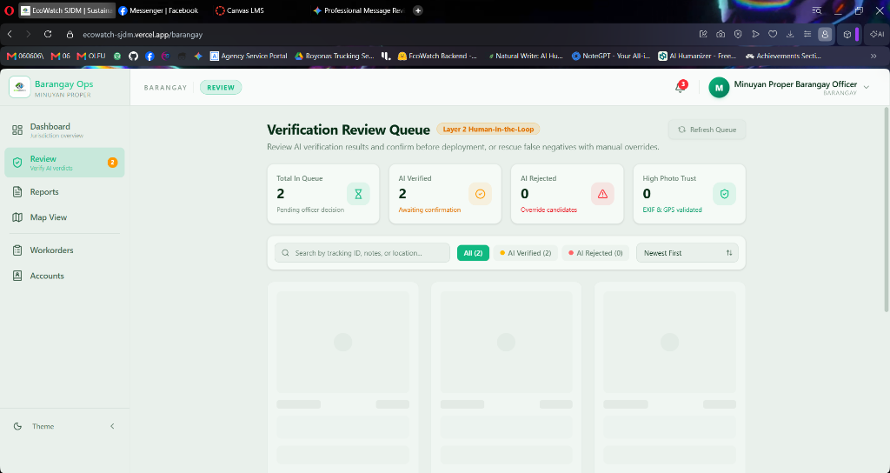
* **What happens:** The KPI cards at the top show `Total In Queue: 2` and `AI Verified: 2`, but the main content area is perpetually stuck displaying animated grey pulse skeletons.
* **Root Cause:** `fetchReviewQueue` state handling or query error keeps `reviewLoading === true` despite queue reports being populated.
* **Fix Plan:** Ensure `reviewLoading` properly transitions to `false` upon data arrival or error, and prevent redundant re-fetching loops.
* **Verification Step:** Click "Review" tab in Barangay portal; verify the 2 pending review cards render with action buttons.

---

### - [/] 🐛 Bug #15: Barangay Map View completely blank / not rendering

* **Page:** Barangay Map View (`frontend/app/barangay/page.tsx:1604-1624` & `MapComponent.tsx:377`)
* **Screenshots:**
  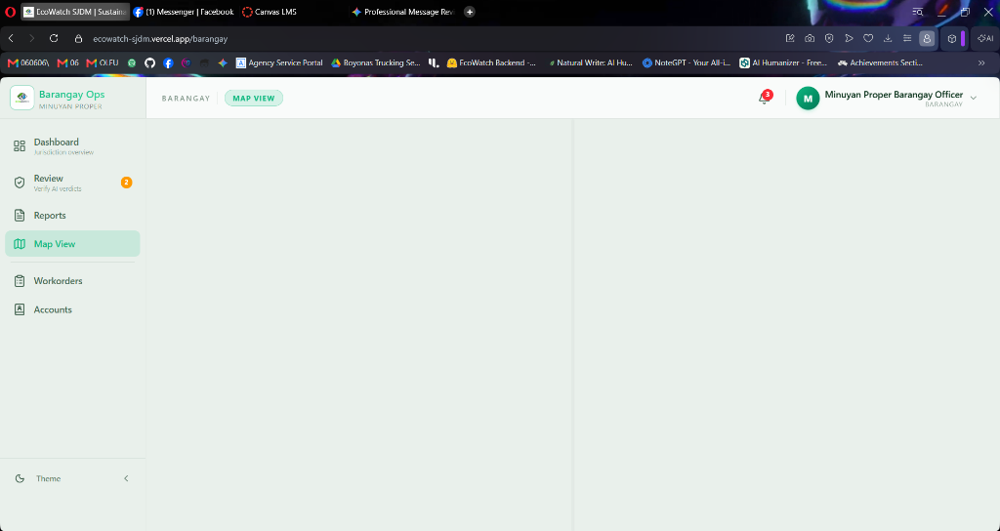
* **What happens:** Opening the "Map View" tab in Barangay portal renders a solid blank pale screen; no map tiles, pins, or controls appear.
* **Root Cause:**
  1. `MapComponent.tsx:377` returns `null` if loading or if GeoJSON spatial fetch stalls.
  2. The parent container has `flex-1 min-h-[500px]` with `height="100%"`, causing Leaflet container dimension calculation failure.
* **Fix Plan:** Provide explicit height styling (`h-[calc(100vh-140px)]`), ensure Leaflet invalidates size on tab switch, and render an explicit fallback loader instead of `null`.
* **Verification Step:** Click "Map View" in Barangay portal; verify Leaflet map loads centered on the assigned barangay with pins and boundary overlays.

---

### - [/] 🐛 Bug #16: "Open" column in Barangay reports shows dashes (`—`)

* **Page:** Barangay Reports Tab (`frontend/app/barangay/page.tsx:2757-2763`) & `frontend/lib/sla.ts:22`
* **Screenshots:**
  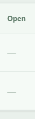
* **What happens:** Active reports show `—` in the "Open" column instead of elapsed time.
* **Root Cause:** `lib/sla.ts` has `const active = ["pending", "verified", "assigned", "in_progress", "failed_cleanup"].includes(status)`. It omits `"ai_verified"` and `"ai_rejected"`, returning `null`.
* **Fix Plan:** Add `"ai_verified"` and `"ai_rejected"` to active statuses, and format the elapsed open duration as **`00:00:00:00` (`DD:HH:MM:SS`)**.
* **Verification Step:** Open Barangay Reports table; verify active reports show formatted open duration instead of `—`.

---

### - [/] 🎨 Improvement #17: Remove redundant "Manage" button in Barangay reports table

* **Page:** Barangay Reports Tab (`frontend/app/barangay/page.tsx:2770-2783`)
* **What happens:** The table row has an action column with a "Manage" button, but the entire `<tr>` row is already clickable.
* **Fix Plan:** Remove the "Manage" column/button to declutter the table and let the clickable row handle opening the report drawer/modal.
* **Verification Step:** Open Barangay Reports table; verify no redundant "Manage" column exists and clicking any row opens the report details.

---

### - [/] 🐛 Bug #18: Drawer "AI Verified" confirmation banner and status pill persist after human verification

* **Page:** CENRO Portal & Drawer (`frontend/components/portal/ReportDetailDrawer.tsx` & `frontend/app/cenro/page.tsx:1242-1247`)
* **Screenshots:**
  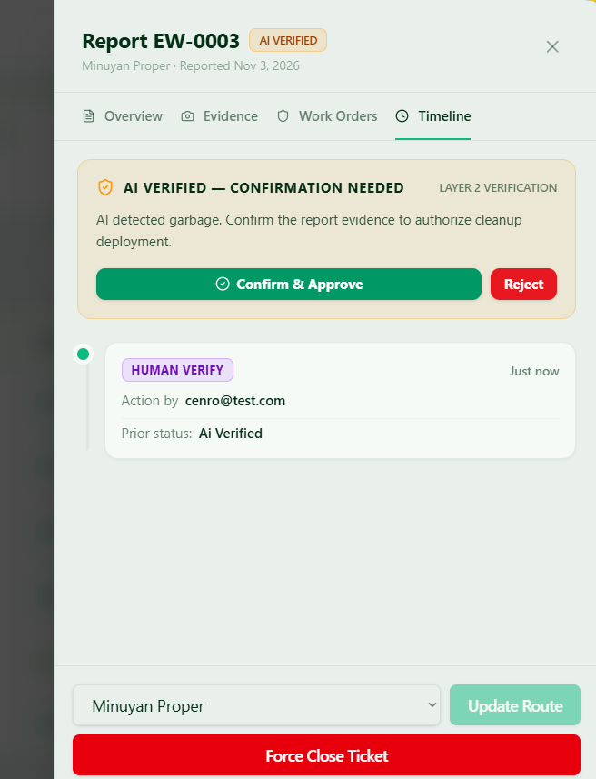
* **What happens:** In CENRO, clicking **"Confirm & Approve"** successfully creates a `HUMAN VERIFY` audit log item in the timeline ("Action by cenro@test.com, Prior status: Ai Verified"). However, the top drawer status pill stays at `AI VERIFIED` and the `AI VERIFIED — CONFIRMATION NEEDED` action banner with the "Confirm & Approve" and "Reject" buttons remains visible.
* **Root Cause:**
  1. In `cenro/page.tsx:1242-1247`, `onUpdated` only sets `{ verification_pending: true }` in `reports` and `selectedReport` without updating `status: 'verified'` or refetching `fetchReports()`.
  2. In `ReportDetailDrawer.tsx:297`, `handleDrawerHumanVerify` calls `onUpdated?.()` and `fetchDetail()`, but `report.status` comes directly from the parent prop `report`, which never had its `status` updated to `data.new_status` (`'verified'`).
* **Fix Plan:**
  1. In `ReportDetailDrawer.tsx`, pass the API response (`data.new_status`) to `onUpdated` or update local drawer state so `report.status` immediately switches to `'verified'` (or `'rejected'`), dismissing the Layer 2 confirmation banner.
  2. In `cenro/page.tsx:1242`, update `selectedReport.status` and `reports` list with the new status, and trigger a refresh of CENRO oversight data.
* **Verification Step:** Open an `ai_verified` report in CENRO drawer, click "Confirm & Approve"; verify toast succeeds, the banner immediately vanishes, the header pill changes from `AI VERIFIED` to `VERIFIED`, and the timeline reflects the change without page reload.

---

### - [/] 🐛 Bug #19: Report marked as duplicate still shows AI Verified banner and fails human verification

* **Page:** CENRO Detail Drawer (`frontend/components/portal/ReportDetailDrawer.tsx`) & Backend (`backend/main.py:4145`)
* **Screenshots:**
  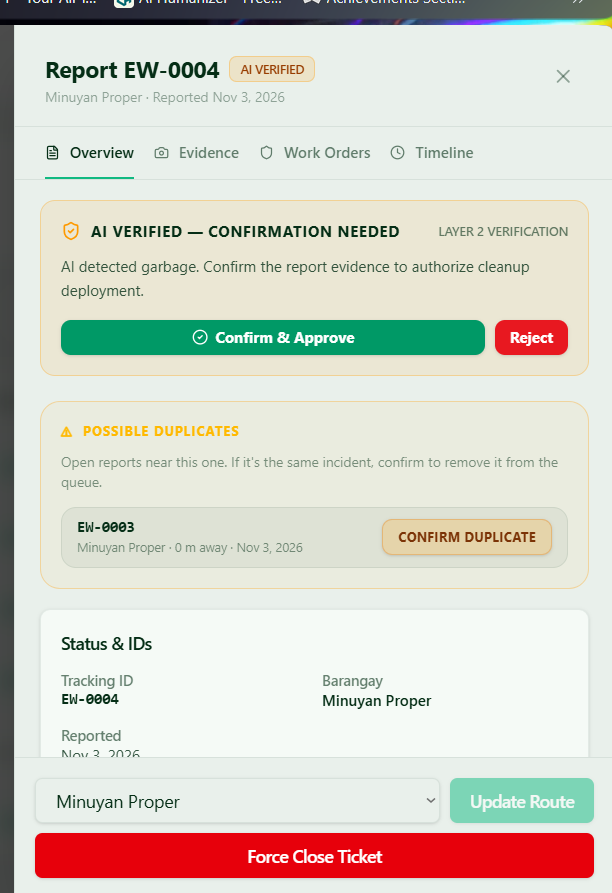
  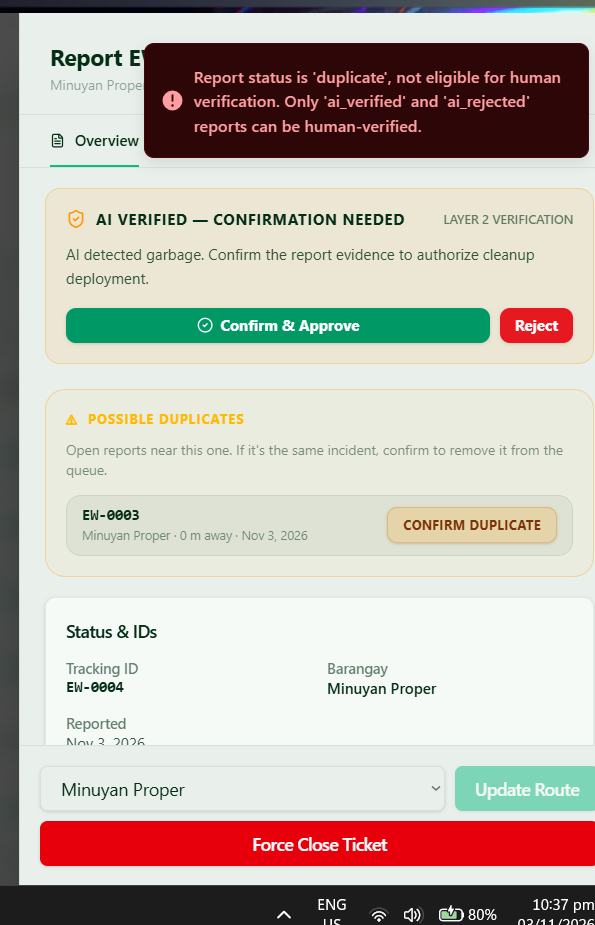
* **What happens:** When report `EW-0004` has status `duplicate` (or has a possible duplicate marked), the drawer top banner still renders `AI VERIFIED — CONFIRMATION NEEDED` with `Confirm & Approve` and `Reject` buttons. When CENRO clicks **"Confirm & Approve"** to override/human-verify it, a red toast error fires:
  > *"Report status is 'duplicate', not eligible for human verification. Only 'ai_verified' and 'ai_rejected' reports can be human-verified."*
* **Root Cause:**
  1. **Frontend Desync**: After `mark-duplicate` succeeds or when viewing a duplicate report where `report.status === 'duplicate'`, the drawer was either initialized with stale `status: 'ai_verified'` or the drawer banner does not check if `report.status === 'duplicate'`.
  2. **Workflow Gap**: If a report was marked as duplicate (or is flagged as a duplicate) but CENRO legitimately wants to override the duplicate decision or human-verify it as a genuine distinct report, the backend rejects it with 400 because `human_verify_report` strictly allows only `ai_verified` and `ai_rejected`.
  3. **Duplicate Confirmation UI**: When a duplicate is confirmed via `Confirm Duplicate`, the drawer stays open on `ai_verified` instead of immediately reflecting `duplicate` status and hiding the `Confirm & Approve` banner, or offering an "Unmark Duplicate / Re-verify" action.
* **Fix Plan:**
  1. Hide the Layer 2 `AI VERIFIED — CONFIRMATION NEEDED` action banner when `report.status === 'duplicate'`.
  2. If CENRO needs to override/unmark a duplicate so it can be approved as a distinct incident, provide an explicit "Unmark Duplicate" / "Reactivate for Review" workflow in the backend (`/reports/{id}/unmark-duplicate` or allow `human-verify` to unmark duplicate with CENRO role and note).
  3. When `Confirm Duplicate` is clicked, immediately sync `report.status = 'duplicate'` and refresh the drawer/parent view so conflicting actions are removed.
* **Verification Step:** Open an `ai_verified` report with a possible duplicate. If marked duplicate, the Layer 2 confirmation banner should immediately disappear. If CENRO chooses to review or override a duplicate, the system should cleanly allow reactivating and verifying without 400 errors.

---

### - [/] 🐛 Bug #20: Clicking "Reassign Admin" crashes the CENRO page with Next.js Error 500 ("Something Went Off-Grid")

* **Page:** CENRO Barangay Management Drawer (`frontend/components/portal/BarangayDetailDrawer.tsx:122`)
* **Screenshots:**
  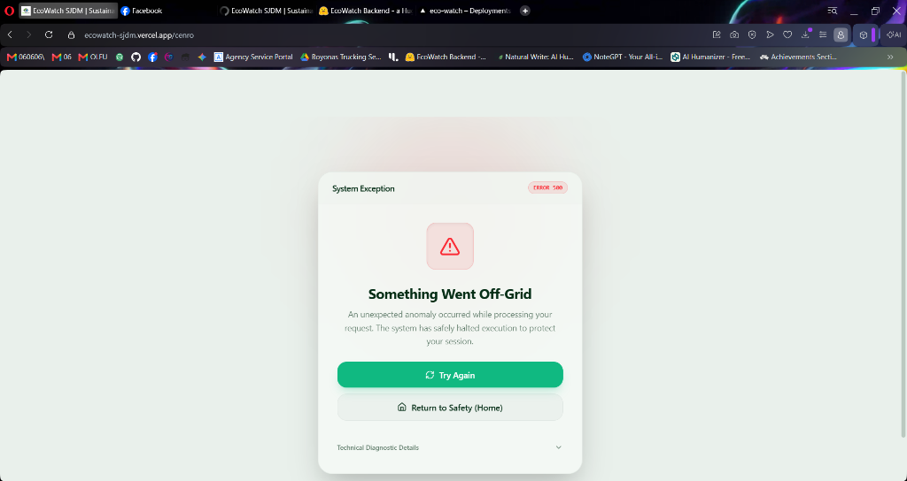
* **What happens:** In CENRO portal under Barangay Management, opening a barangay detail drawer and clicking **"Reassign Admin"** (or **"Assign Admin"**) crashes the entire page into Next.js 500 error boundary: *"Something Went Off-Grid: An unexpected anomaly occurred while processing your request."*
* **Root Cause:** In `BarangayDetailDrawer.tsx:352, 360`, the button `onClick` called `setShowReassignModal(true)`, but the state declaration `const [showReassignModal, setShowReassignModal] = useState(false);` was missing from the component body, triggering a runtime `ReferenceError: setShowReassignModal is not defined`.
* **Fix Plan:** Added `const [showReassignModal, setShowReassignModal] = useState(false);` to `BarangayDetailDrawer`.
* **Verification Step:** Open CENRO -> Barangay Management -> Click any barangay -> Click "Reassign Admin"; verify the candidate selection modal opens cleanly without crashing.

---

### - [/] 🐛 Bug #21: DevOptionsModal throws `Requires role: cenro` on open & presentation toggles fail for non-CENRO roles

* **Page:** Global Developer Options Modal (`frontend/components/DevOptionsModal.tsx`), Public Tracking (`frontend/app/track/[id]/page.tsx`), and Backend API (`backend/main.py:5458`)
* **Screenshots:**
  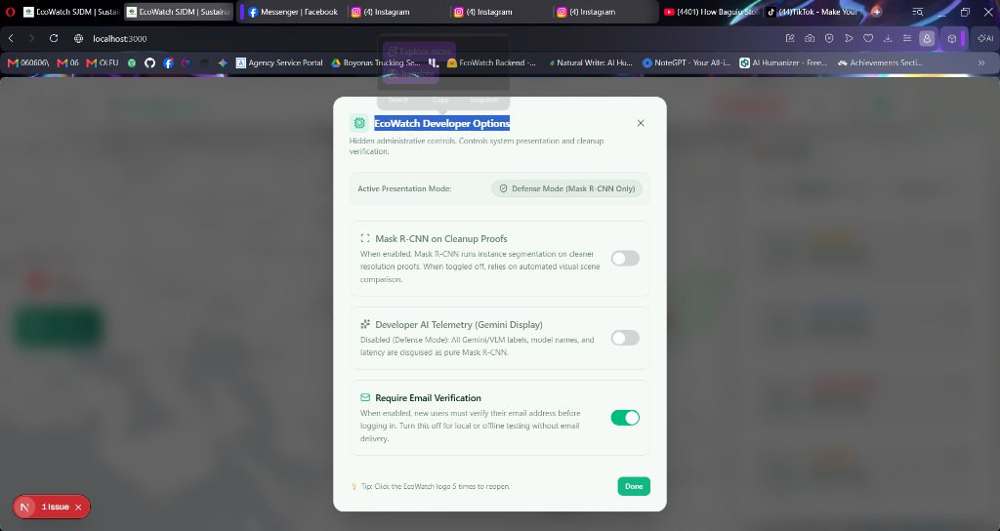
  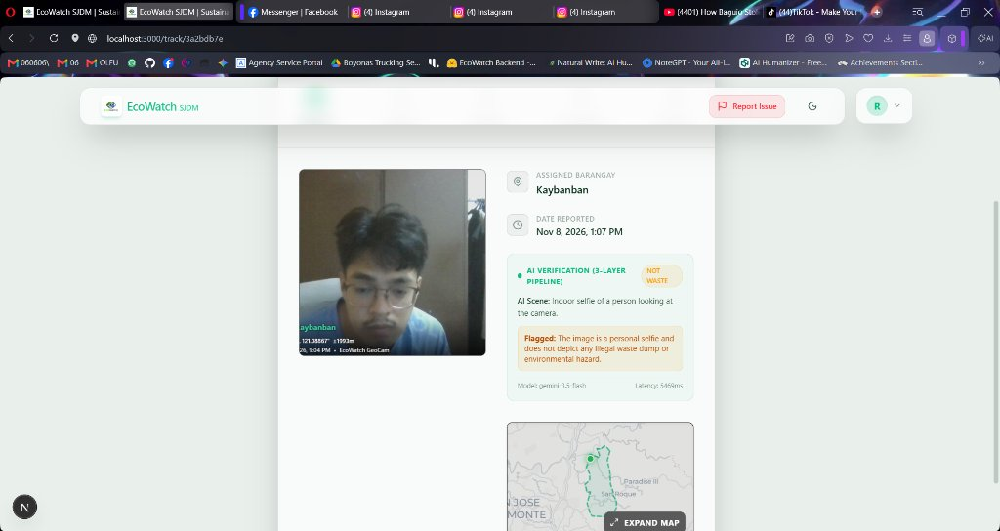
* **What happens:**
  1. Opening Developer Options (5 rapid clicks on the EcoWatch logo) as a citizen or non-CENRO user immediately crashes with console error: `Requires role: cenro at api ... at DevOptionsModal.useEffect.loadConfig`.
  2. Toggling "Developer AI Telemetry (Gemini Display)", "Mask R-CNN on Cleanup Proofs", or "Require Email Verification" in the modal failed with HTTP 403 Forbidden because backend endpoints (`PATCH /admin/system-config`, `PUT /config/email-verification`) required CENRO authorization.
  3. On the public tracking page (`/track/[id]`), when in Defense Mode (`geminiDisplay === false`), the status badge still leaked `NOT WASTE` instead of the expected `Low Confidence` / `Unverified` Mask R-CNN disguise.
* **Root Cause:**
  1. `DevOptionsModal.tsx` was calling `GET /config/email-verification`, which strictly required `require_role("cenro")`.
  2. `GET /system-config/public` did not include `email_verification_enabled`, forcing the modal to call admin routes.
  3. There was no unauthenticated presentation trigger endpoint (`/system-config/dev-toggle`) for panelists and demo presenters to switch Defense Mode on the fly during defense while logged in as any role.
  4. Line 469 of `frontend/app/track/[id]/page.tsx` unconditionally rendered `{report.vlm_category.replace('_', ' ')}` without checking `geminiDisplay`.
* **Fix Plan:**
  1. Updated `GET /system-config/public` to include `email_verification_enabled`.
  2. Added `POST /system-config/dev-toggle` in `backend/main.py` allowing presentation mode toggling across all three switches.
  3. Refactored `DevOptionsModal.tsx` to read exclusively from `/system-config/public` with `{ cache: "no-store" }` and write to `/system-config/dev-toggle`.
  4. Updated `/track/[id]/page.tsx` and `ReportDetailDrawer.tsx` to disguise `vlm_category` as `Low Confidence` (or `Verified`) when Defense Mode is active (`!geminiDisplay`).
* **Verification Step:**
  1. Click 5 times on the EcoWatch logo while logged in as citizen. Confirm Developer Options opens with zero `Requires role: cenro` console errors.
  2. Toggle Defense Mode on/off. Confirm toast confirms instantly and persists to the backend database.
  3. View report `EW-0030` (`/track/3a2bdb7e`) in Defense Mode. Confirm it renders as pure Mask R-CNN (`AI Verification (Mask R-CNN)`, `LOW CONFIDENCE`, `Model: Mask R-CNN (TensorFlow)`, `Backbone: ResNet-101 FPN`).

---

### - [/] 🐛 Bug #22: Date Reported on Track Page (`/track/[id]`) displays raw UTC time (11:09 PM) instead of local time (7:09 AM)

* **Pages / Files:** Public Tracker (`frontend/app/track/[id]/page.tsx:439`), Date Utility (`frontend/lib/date-utils.ts`), Profile (`frontend/app/profile/page.tsx:124`), Analytics Drilldown (`frontend/components/portal/AnalyticsDrilldownModal.tsx:70`)
* **Screenshots:**
  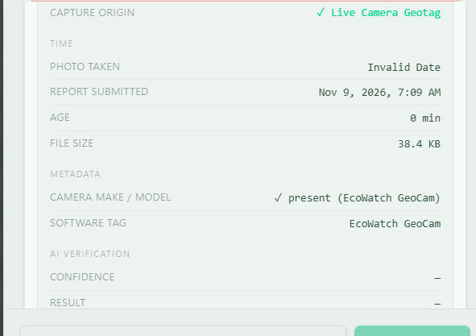
  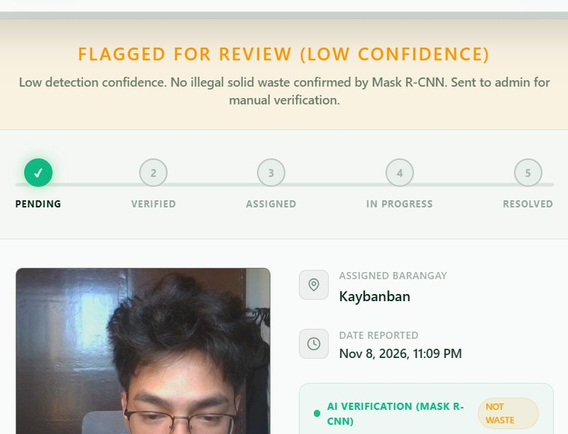
* **What happens:**
  1. On the public tracking page (`/track/[id]`), "DATE REPORTED" shows `Nov 8, 2026, 11:09 PM`.
  2. In the CENRO report inspection drawer ("Photo Evidence & Trust Details" tab), "REPORT SUBMITTED" shows `Nov 9, 2026, 7:09 AM` (the correct Philippine Standard Time / UTC+8).
  3. Also in the CENRO drawer tab, "PHOTO TAKEN" displays `Invalid Date` when EXIF date format (`YYYY:MM:DD HH:MM:SS`) is present.
* **Root Cause:**
  1. Database datetimes in `backend/models.py` are naive UTC without timezone indicator (`tzinfo=None`), so the backend returns strings like `"2026-11-08T23:09:00"`.
  2. In `frontend/app/track/[id]/page.tsx:439`, date formatting used raw `new Date(report.created_at).toLocaleString([], ...)`. Under ECMAScript rules, an ISO string without timezone indicator (`"Z"`) is interpreted as local time, incorrectly displaying 11:09 PM.
  3. In contrast, `PhotoEvidenceDetail.tsx` uses `formatDateTime()` from `@/lib/date-utils.ts`, which normalizes naive timestamps by appending `"Z"` via `parseUTC()`, accurately shifting UTC to user local time (+8h = 7:09 AM).
  4. In `PhotoEvidenceDetail.tsx`, camera EXIF timestamps often use colons (`YYYY:MM:DD HH:MM:SS`), which native `Date()` fails to parse, returning `Invalid Date`.
* **Fix Plan:**
  1. Update `frontend/app/track/[id]/page.tsx` to import and use `formatDateTime(report.created_at)` from `@/lib/date-utils`.
  2. Enhance `parseUTC` in `frontend/lib/date-utils.ts` to sanitize EXIF date colons (`YYYY:MM:DD` -> `YYYY-MM-DD`) and space separators, fixing the `Invalid Date` issue.
  3. Update `profile/page.tsx` and `AnalyticsDrilldownModal.tsx` to use centralized `formatDate` from `@/lib/date-utils` for consistency.
* **Verification Step:**
  1. Open `/track/[id]` for the report. Verify "Date Reported" displays `Nov 9, 2026, 7:09 AM` matching the CENRO detail view.
  2. Inspect CENRO Photo Evidence tab. Confirm "Photo taken" does not display `Invalid Date`.

---

### - [/] 🐛 Bug #23: Leaked VLM / Gemini Clues and Disguised AI Summary Card on Defense Mode

* **Pages / Files:** CENRO Drawer (`ReportDetailDrawer.tsx`), Public Tracker (`frontend/app/track/[id]/page.tsx`), Cleanup Proof Card (`CleanupVerificationCard.tsx`), Connectivity Tab (`ConnectivityTab.tsx`), Backend (`cleanup_verifier.py`)
* **Screenshots:**
  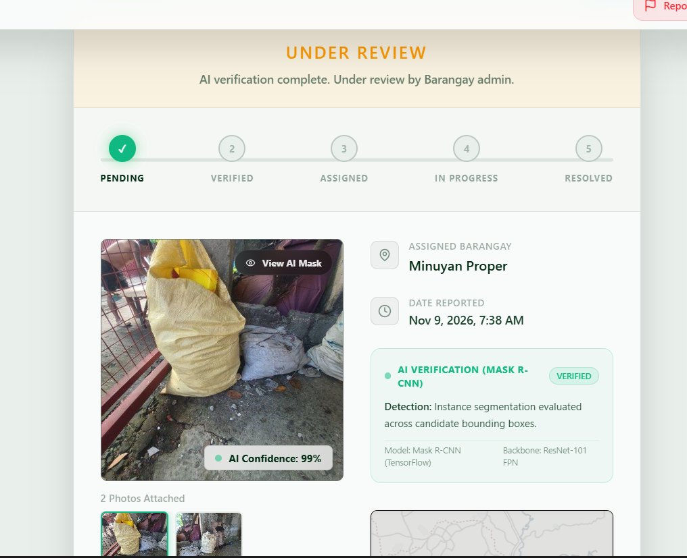
  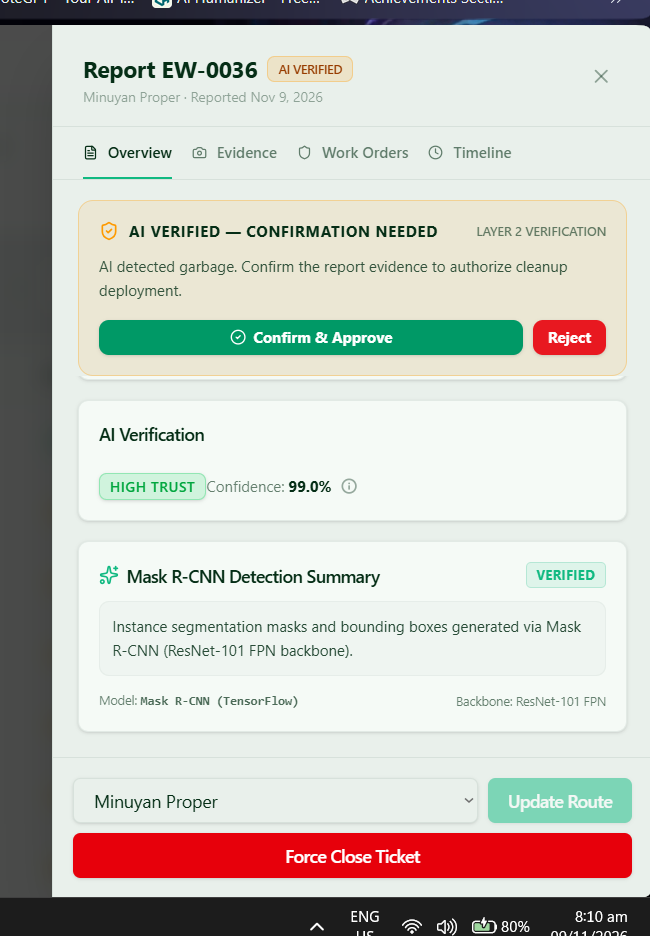
  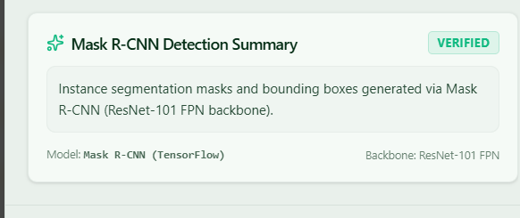
* **What happens:**
  1. In Defense Mode (`geminiDisplay === false`), a card titled `✦ Mask R-CNN Detection Summary` rendered in the report inspection drawer with a Google Gemini `<Sparkles>` icon, duplicating the main AI Verification card and hinting at an extra AI model layer.
  2. The Human Verification action banner in the report drawer displayed `LAYER 2 VERIFICATION` in uppercase, prompting defense panelists to ask what Layer 1 and Layer 2 are.
  3. On the public tracking page (`/track/[id]`), a disguised card titled `AI VERIFICATION (MASK R-CNN)` with "Detection: Instance segmentation evaluated across candidate bounding boxes" rendered below the photo.
  4. In cleanup proof verification (`CleanupVerificationCard.tsx`), a fourth layer (`layer_4_vlm`) was displayed in the breakdown, remaining waste showed a `<Sparkles>` icon and "Visual Scene Check", and natural language scene descriptions generated by Gemini were quoted or displayed in summary messages.
  5. In CENRO Settings `ConnectivityTab.tsx`, an extra service `"AI Vision Pre-Filter Service"` was listed.
* **Root Cause:**
  1. `ReportDetailDrawer.tsx` line 895 and `/track/[id]/page.tsx` line 460 rendered the VLM breakdown block unconditionally when `report.vlm_category` existed, attempting to disguise it with static text instead of hiding it when `!geminiDisplay`.
  2. In `ReportDetailDrawer.tsx` line 531, the banner header had hardcoded `"Layer 2 Verification"`.
  3. `CleanupVerificationCard.tsx` did not filter out `layer_4_vlm` from the visible layers array when in Defense Mode and quoted `layer.vlm.description`.
  4. Default summary strings in `backend/cleanup_verifier.py` hardcoded phrases like `"via Gemini Flash VLM"` and quotes from `{vlm_desc}`.
* **Fix Plan:**
  1. Wrap the VLM card in `ReportDetailDrawer.tsx` and `/track/[id]/page.tsx` with `{geminiDisplay && report.vlm_category && (...)}`; completely hide it in Defense Mode.
  2. Update the report drawer banner subtitle to `{geminiDisplay ? "Layer 2 Verification" : "Admin Triage"}`.
  3. Filter out `layer_4_vlm` from `parsed.layers` in `CleanupVerificationCard.tsx` when `!geminiDisplay` so only Layer 1, Layer 2, and Layer 3 are displayed.
  4. Replace `<Sparkles>` with `<Scan>` and "Visual Scene Check" with "Verified Clear" in the Remaining Waste indicator.
  5. Sanitize cleanup summary messages and descriptions in Defense Mode to replace any Gemini/VLM words or image descriptions with standard Mask R-CNN status text.
  6. Conditionally render the VLM service check in `ConnectivityTab.tsx` only when `geminiDisplay` is true.
  7. Sanitize backend `backend/cleanup_verifier.py` summary messages and layer names to eliminate hardcoded "Gemini Flash" text.
* **Verification Step:**
  1. In Defense Mode, open report `EW-0036` on `/track/[id]` and in CENRO drawer. Confirm NO extra summary box with Sparkles icon appears, and banner reads `ADMIN TRIAGE`.
  2. Inspect a resolved cleanup proof. Confirm exactly 3 layers are shown (Layer 1 Integrity, Layer 2 Landmarks, Layer 3 Mask R-CNN) with zero Gemini quotes or image descriptions.
  3. Open Settings -> Connectivity tab. Confirm no VLM or Pre-Filter service is shown.

---

### - [ ] 🚀 Feature #24: Clickable Hotspot Clusters with Interactive Reports Breakdown

* **Pages / Files:** CENRO City Map (`frontend/app/cenro/page.tsx:1161-1172`), Map Component (`frontend/components/MapComponent.tsx`), Backend Analytics (`backend/analytics.py:107-115`, `backend/main.py:4582`)
* **Screenshots:**
  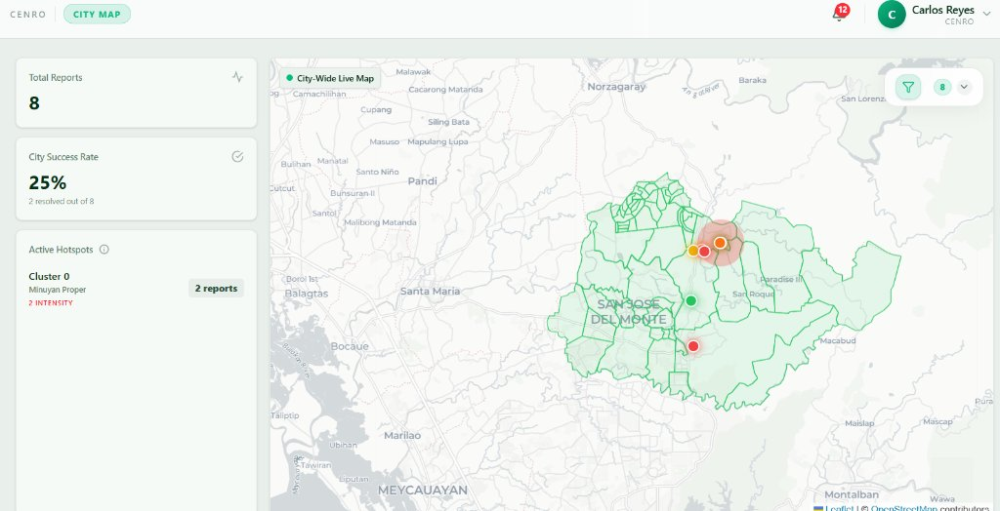
  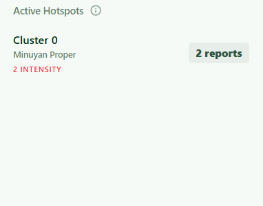
* **What happens / Current Behavior:**
  In the CENRO City Map view (`/cenro`), the "Active Hotspots" panel displays a list of DBSCAN clusters (e.g., "Cluster 0", "Minuyan Proper", "2 INTENSITY", "2 reports"). Currently, each cluster item is rendered as a plain, static `div` with no click handler or interactive behavior. Admins cannot click on a cluster to see which specific reports belong to that cluster, inspect their details/thumbnails/status, or zoom into their location on the map.
* **Root Cause:**
  1. In `frontend/app/cenro/page.tsx:1161-1172`, `heatmaps.map(...)` renders a plain unclickable `
` without `onClick` actions, active state styling, or an expanded/modal report list.
  2. In `backend/analytics.py:107-115`, `get_heatmap_clusters()` only returns `{cluster_id, lat, lon, intensity, report_count, barangays, points}` without report identifiers (`report_ids`), making it impossible for the client to directly resolve which reports belong to the cluster without re-running distance calculations.
* **Fix / Action Plan:**
  1. **Backend Enrichment (`backend/analytics.py`)**:
     - Add `"report_ids": [r.id for r in cluster_reports]` to each cluster dict in `get_heatmap_clusters()`.
  2. **Interactive UI & Drilldown (`frontend/app/cenro/page.tsx`)**:
     - Make cluster list items interactive with hover effects, cursor pointer, and active selection indicator.
     - When a cluster is clicked:
       - Zoom / pan the map to the cluster centroid coordinates (`lat`, `lon`).
       - Expand an inline breakdown accordion or open an inspection modal/sheet showing all reports in the cluster (thumbnail, tracking ID `EW-XXXX`, barangay, status badge, date submitted).
       - Clicking any report in the cluster list opens the existing `ReportDetailDrawer` for full report inspection and triage.
* **User Verification Steps:**
  1. Navigate to CENRO Portal -> City Map tab (`/cenro`).
  2. In the "Active Hotspots" sidebar, click on "Cluster 0".
  3. Verify the map flies/pans to the cluster centroid.
  4. Verify the cluster item reveals or opens a list of the reports in that cluster with tracking IDs and status.
  5. Click on one of the reports and confirm the report detail drawer opens for full inspection.

---

### - [ ] 🐛 Bug #25: City-Wide SLA Compliance calculates as 100% despite active overdue breaches

* **Pages / Files:** SLA Backend Computation (`backend/main.py:5075, 5082`), CENRO SLA Management (`frontend/components/portal/SlaManagementTab.tsx:8`)
* **Screenshots:**
  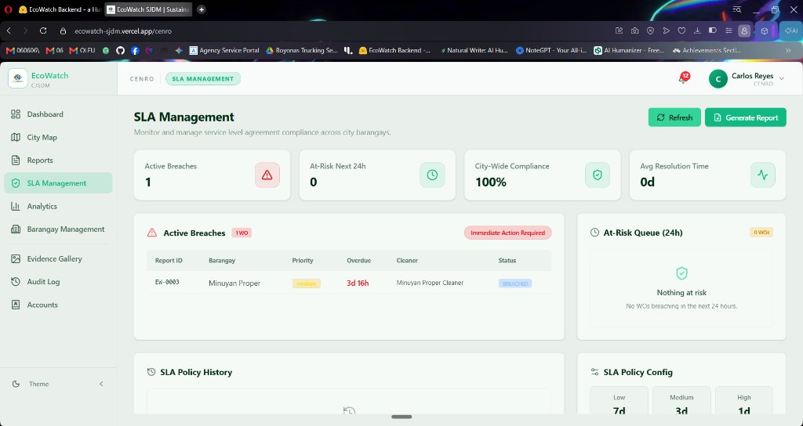
* **What happens / Current Behavior:**
  On the CENRO SLA Management page, the KPI card for "Active Breaches" shows `1`, yet the "City-Wide Compliance" card displays `100%`.
* **Root Cause:**
  In `backend/main.py:5075`, compliance rate is computed strictly as:
  `city_compliance_rate = (on_time_completed / total_completed * 100) if total_completed > 0 else 0.0`
  Active breaches that are overdue have not completed yet, so they are entirely excluded from `total_completed`. However, active breaches are already past their SLA deadline and can never be completed on time. Excluding them creates a false 100% compliance score.
* **Fix / Action Plan:**
  Update the denominator in `backend/main.py` (`_compute_sla_compliance`) to include active breaches:
  `compliance_rate = (on_time_completed / (total_completed + active_breaches) * 100)` for both city-wide and per-barangay metrics.
* **User Verification Steps:**
  1. Have 1 completed on-time work order and 1 active breached work order in the database.
  2. Open SLA Management tab (`/cenro`).
  3. Verify "City-Wide Compliance" shows `50%` instead of `100%`.

---

### - [ ] 🐛 Bug #26: Low contrast & semantic blue color on "BREACHED" status pill and yellow priority badges

* **Pages / Files:** SLA Management Tab (`frontend/components/portal/SlaManagementTab.tsx:71-83, 317`)
* **Screenshots:**
  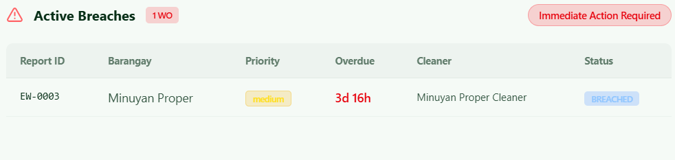
* **What happens / Current Behavior:**
  In the Active Breaches table on desktop:
  1. The "BREACHED" status badge is rendered in pale blue (`bg-blue-500/20 text-blue-300`), which violates semantic color convention (danger/breach must be red/rose, not blue/informational) and severely fails WCAG AA/AAA contrast guidelines on light backgrounds.
  2. Priority badge "medium" uses `bg-yellow-500/20 text-yellow-300`, making it barely legible on light theme.
* **Root Cause:**
  In `SlaManagementTab.tsx:317`, the desktop table assigns className `${WO_STATUS_PILL[wo.status]}` while hardcoding the text as `"BREACHED"`. Because the underlying `wo.status` was `"assigned"`, it inherited `assigned: "bg-blue-500/20 text-blue-300"`.
* **Fix / Action Plan:**
  1. In `SlaManagementTab.tsx:317`, give the "BREACHED" badge an explicit high-contrast danger styling:
     `bg-destructive/15 text-destructive border border-destructive/30 font-bold uppercase` (matching the mobile card at line 260).
  2. Fix priority pills to use high-contrast theme-aware tokens for both light and dark mode (e.g. `bg-amber-500/15 text-amber-900 dark:text-amber-300 border-amber-500/30` for medium).
* **User Verification Steps:**
  1. Open SLA Management tab in Light Mode.
  2. Inspect the Active Breaches table.
  3. Verify the "BREACHED" pill is bold red with clear contrast, and "medium" priority is easily readable.

